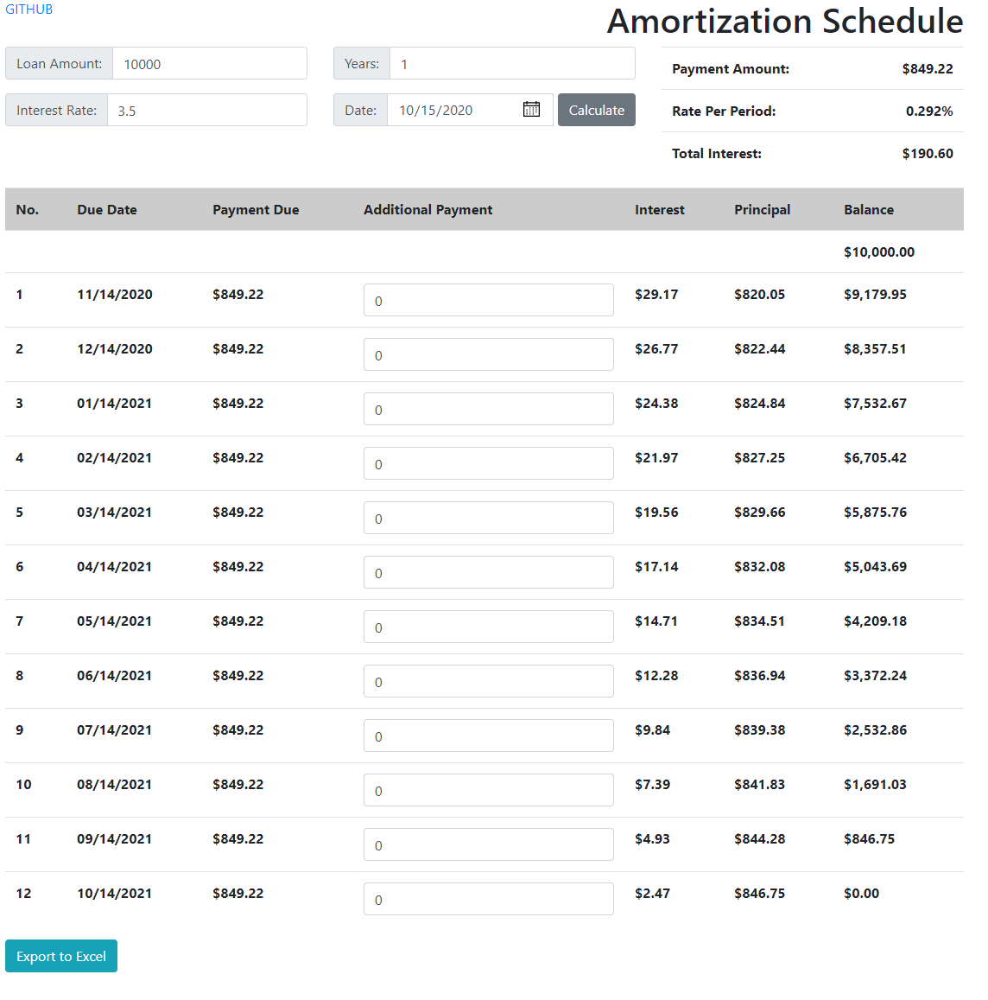

# Amortization Schedule

Amortized Loans are something that everyone needs at some point in life. 
Most of the loan calculators didn't have the feature I was looking for, and tend to divert you to some lender instead.
I just wanted something that was simple to comprehend and removed all the distractions.
Nothing fancy here just a static html site

## Features

- Monthly payment, total interest and payoff date
- Term in years or months (e.g. a 72-month auto loan)
- Extra payments: every month, once a year, a one-time lump sum, or any amount typed into a single row
- Shows how much earlier the loan is paid off and how much interest the extra payments save
- Remembers your last loan in the browser; extra payments are kept per loan
- Dark theme by default, with a light/dark toggle
- Export the schedule to Excel

## Demo

https://truedeity.github.io/AmortizationSchedule/

## Screenshot

## Donate
If this makes your life any easier buy me a coffee
https://ko-fi.com/danielnewman

